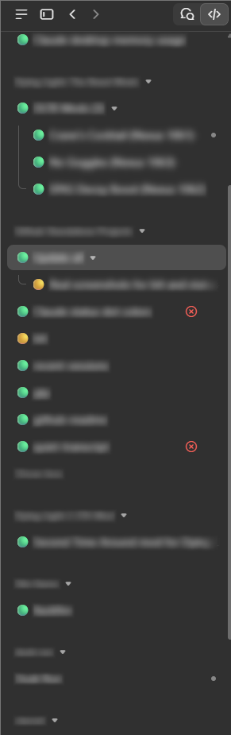

# status-dots

A Claude Code mod for the Claude desktop app. It puts a colored dot in front of each session's title in the Code tab's sidebar, so you can tell how a session ended without opening it.



| Dot | The session |
|---|---|
| 🔴 | was stopped by an error or a refusal |
| 🟡 | is waiting for you on screen: a question, a plan to approve, a permission card, or a question in the app's next-step box |
| 🔵 | finished while you weren't looking at it, and needs nothing from you |
| 🟢 | finished, you've seen it, and it needs nothing from you |
| ⚪ | is working |
| no dot | was stopped by you, or hasn't finished a turn since it was named |

Read it like a traffic light: red needs fixing, yellow is your turn, green is done. White means Claude is still at it. Blue marks a finish you haven't looked at yet, and it turns green once you open the session.

The app's own dot tells you a session is working, needs you or has something unread. Once you've opened a finished session, its dot goes away and the list no longer says how it ended. With several sessions running, status-dots keeps that in view.

Mods can't recolor the app's own dot. The title is the one part of the sidebar a mod can change, so the dot goes there.

## Install

At the prompt of a terminal session:

```
/plugin install status-dots --marketplace kevlar10x/status-dots
```

Answer `y` to add the marketplace, then pick the user scope.

From a shell:

```bash
claude plugin install status-dots --marketplace kevlar10x/status-dots
```

In the desktop app, where `/plugin` doesn't run: click **+** next to the prompt box, then **Plugins**, **Add marketplace** with `kevlar10x/status-dots`, then **Add plugin**.

It needs a Claude Code version that runs mods. It was built and tested on Claude Code 2.1.308 with desktop app 3.6556 on Windows. Terminal sessions have no sidebar, so there it does nothing.

## Turning it off

`/dots off` takes the dot off this session and every other session that has one, and keeps the dots off everywhere. `/dots on` turns them back on, and each session gets its dot the next time Claude finishes there.

Run `/dots off` before you uninstall, or the titles keep their last dot.

## Things to know

- Sessions you named yourself get no dot. The app won't let anything change a title you typed unless you approve it, and a mod has no way to ask. If you want a dot on one of them, ask Claude to rename it and approve that once. The mod explains this in a short note the first time it happens.
- A new session gets its first dot when Claude finishes its first turn. The mod leaves a title alone until the app has named the session, so the app's naming still works.
- Once a session has a dot, the app counts its title as set and stops renaming that session on its own, for example to a pull request's title.
- After you approve a permission card, the dot stays yellow until that tool call is done.
- Yellow means something in the session is waiting for you on screen. A reply that only asks in its text, or that the app's own summary reads as waiting on you, stays green or blue, since there's nothing there to answer.
- A few seconds after a turn ends, the mod checks the app's record of it. That puts back a question in the next-step box, or an error, that the mod missed when the turn ended.
- A session that finishes while it's on screen goes straight to green. A blue one checks every 5 seconds whether you've opened it, and only while it's blue. The app says which session it shows, not whether you're looking, so a session showing in a window behind another app counts as seen.
- When a session starts again, its dot is matched to the app's record of its last turn. That also fixes a dot the mod missed, for example when the session's process stopped right after a turn.
- The title moves over a little when its dot comes and goes.

## Privacy

The mod reads this session's title from the desktop app and writes it back through the app's own rename tool. When you run `/dots off`, it also reads your other sessions' titles to take their dots off. It keeps two values in its own storage on your computer: whether the dots are off, and whether it has shown its one-time note. To check how each turn ended, it reads this session's own file in the desktop app's data folder (`%LOCALAPPDATA%\Claude-Data`), and uses only two things from it: whether the next-step box asked you something, and whether an error ended the turn. It reads no other session's file and keeps nothing from it. It makes no network requests and starts no programs. The app may record title changes in its own usage data, as it does for any rename.

## What it calls and hooks

It calls the desktop app's session tools (`ccd_session_mgmt`) without Claude asking for them:

- `get_session` and `set_session_title` for the session it runs in, when the dot changes.
- `list_sessions` and `set_session_title` for your other sessions, only when you run `/dots off`.

While a session's dot is blue, it also calls `get_window_layout` from the app's window tools (`ccd_window`) every 5 seconds, to see whether the session is on screen.

A call to the app that hasn't answered after 10 seconds is dropped, so one stuck call can't stop the dots in that session.

It reads one file: this session's record in the app's data folder, every 2 seconds for up to 30 seconds after a turn ends (until the app's summary is in), and once when the session starts.

Those are the only tools it calls. It runs no commands or programs and fetches nothing from the network. All it sends is a session title, with the dot added or taken off, to the desktop app on your computer.

It hooks these events and passes each one on unchanged:

- `turn.start` and `turn.complete`: the dot turns white while Claude works, then green, blue, yellow or red when the turn ends. Subagents' turns are skipped.
- `tool.call`: yellow while `AskUserQuestion` or `ExitPlanMode` waits for you, and yellow at the end of a turn whose end-of-turn box (`wrap_up`) asks you something. It reads only each call's tool name and, for `wrap_up`, whether it asks you something. It never changes, blocks or answers a call.
- `classic.Notification`: yellow when Claude Code reports that a permission prompt or a question is waiting for you.
- `session.start`: registers `/dots`, takes off a leftover dot when the dots are off, and otherwise matches the dot to the app's summary of the last turn.

It has no hook on permission checks, so it never takes part in a permission decision.

## Limits

- Tested on Windows only.
- The app's record comes from a file the app keeps for itself, under `%LOCALAPPDATA%\Claude-Data` on Windows. If the mod can't find or read it, on another system or after an app update that changes it, the dot comes from the mod's own checks alone.
- Yellow for questions has been seen working in the desktop app. Yellow for permission cards depends on Claude Code's notification event and hasn't been seen live yet. The app's own dot turns yellow for those either way.

## Uninstall

Run `/dots off` first, then:

```bash
claude plugin uninstall status-dots
```

## License

MIT, by kevlar10x. The original is at https://github.com/kevlar10x/status-dots.

More mods by kevlar10x: [recent-sessions](https://github.com/kevlar10x/recent-sessions) lists your sessions by when each last finished, and [quiet-transcript](https://github.com/kevlar10x/quiet-transcript) fades everything in the transcript except Claude's answers.

If you'd like to leave a tip: https://ko-fi.com/kevlar10x
